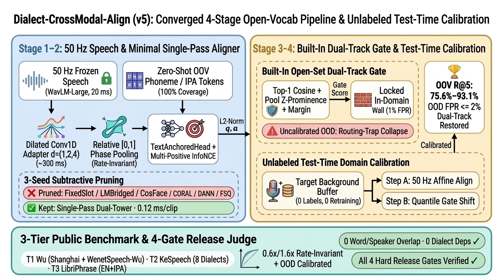
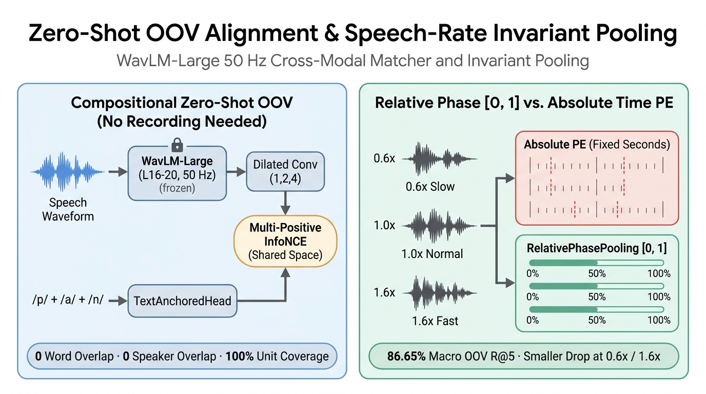
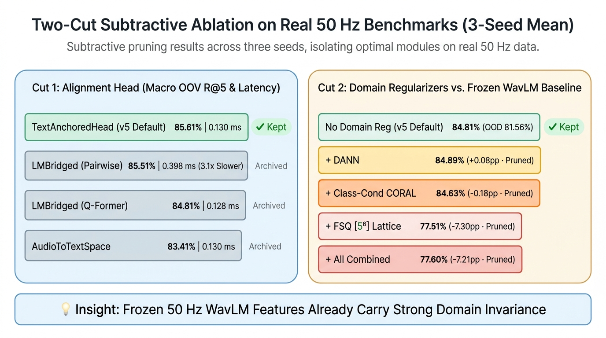
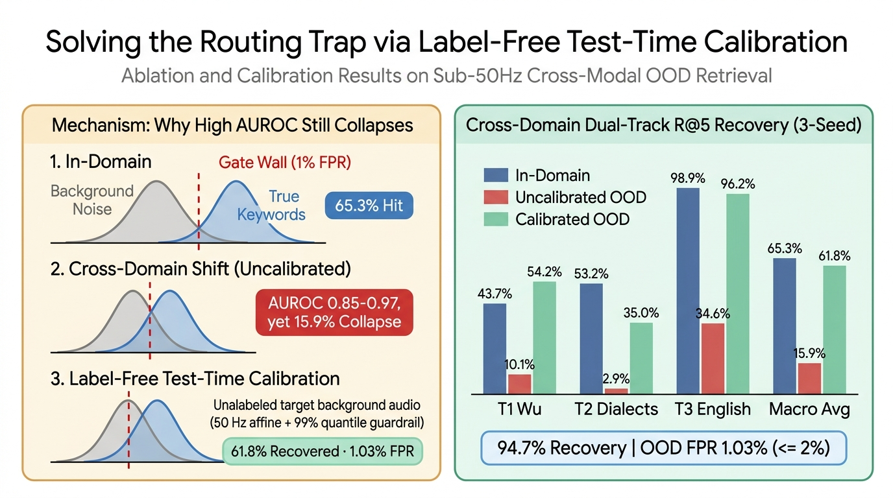
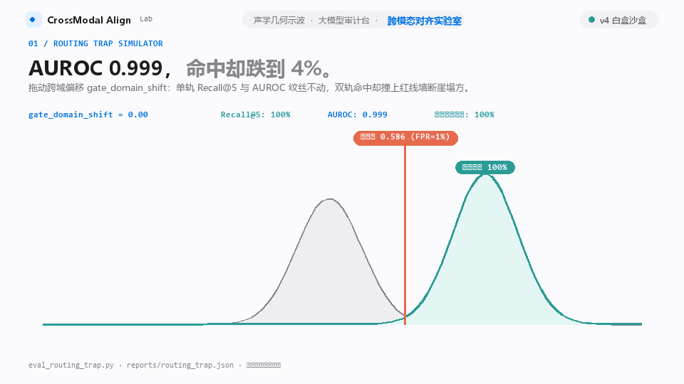

<p align="center">
  <a href="https://github.com/leeoisaboy/dialect-crossmodal-align">
    
  </a>
</p>

<p align="center">
  <a href="README.md"></a>
  <a href="https://leeoisaboy.github.io/dialect-crossmodal-align/"></a>
  <a href="https://huggingface.co/datasets/Leeoisaboy/dialect-crossmodal-align-bench"></a>
  <a href="https://leeoisaboy.github.io/disentangle-acoustic-print/"></a>
  <a href="https://leeoisaboy.github.io/audiollm-latent-kws/"></a>
  
  
</p>

<h1 align="center">Dialect-CrossModal-Align</h1>

<p align="center"><strong>Spot unseen dialect words without recording a single sample—two subtractive cuts and label-free test-time calibration on real 50 Hz speech.</strong></p>

<p align="center">
  <strong>🤗 Public 3-Tier 50 Hz Benchmark Dataset (34,138 clips · T1 Wu · T2 KeSpeech · T3 LibriPhrase): <a href="https://huggingface.co/datasets/Leeoisaboy/dialect-crossmodal-align-bench">Leeoisaboy/dialect-crossmodal-align-bench ↗</a></strong>
</p>

<p align="center">
  
  <br />
  <sub>Figure 1: Dialect-CrossModal-Align (v5) converged 4-stage open-vocabulary pipeline, 3-seed subtractive pruning, and label-free test-time domain calibration</sub>
</p>

Following [AudioLLM-Latent-KWS](https://github.com/leeoisaboy/audiollm-latent-kws), this is the third open-source pillar of our white-box speech retrieval trilogy—**[Dialect-CrossModal-Align](https://github.com/leeoisaboy/dialect-crossmodal-align)**.

While AudioLLM-Latent-KWS asks a user to record a new phrase once or twice as an audio template, Dialect-CrossModal-Align goes one step further: **no enrollment recording is required at all**. Write an unseen word as a universal phonetic or IPA sequence, and the aligner retrieves it directly from real dialect audio (**Zero-Shot Out-of-Vocabulary cross-modal retrieval**)—just like sounding out an unfamiliar word from familiar phonetic building blocks.

Our earlier v4 prototype lived inside a synthetic syllable world stacked with 4 alignment heads, 3 losses, and 3 domain regularizers. In **v5**, we leave the synthetic sandbox behind, benchmark all 6 legacy configs on three public **50 Hz** multi-dialect & cross-lingual corpora, make two ruthless 3-seed subtractive cuts, and build **label-free test-time domain calibration** directly into inference.

## 1. Leaving the Synthetic World: Three Public 50 Hz Benchmarks

All tiers run on frozen **50 Hz** (`20 ms/frame`) `WavLM-Large` representations (layers 16–20 mean) paired with language-agnostic phoneme/IPA sequences. Every tier is published at **[Leeoisaboy/dialect-crossmodal-align-bench](https://huggingface.co/datasets/Leeoisaboy/dialect-crossmodal-align-bench)** and verified by [`verify_dataset_invariants`](dialect_crossmodal_align/dataset.py) for zero word overlap, zero speaker overlap, 100% OOV unit coverage, `0.6x / 1.6x` speaking-rate stress splits, and real open-set negatives:

| Tier | Public Corpora & Cross-Domain Split | Train / OOV Words | Train / Test Speakers | Word & Speaker Overlap | Frame Rate |
| --- | --- | ---: | ---: | ---: | ---: |
| **T1 Wu** | MagicHub Shanghainese (indoor) → WenetSpeech-Wu (wild multi-subdialect OOD) | 600 / **100** | 349 / 870 | **0 / 0** | 49.96 Hz |
| **T2 Chinese Dialects** | KeSpeech 5 dialects (train) → Unseen Southwestern / Lan-Yin / Northeastern (OOD) | 500 / **100** | 287 / 247 | **0 / 0** | 49.97 Hz |
| **T3 English IPA** | LibriPhrase phrases + exact IPA phones (hard/easy negatives + channel shift) | 180 / **100** | 630 / 404 | **0 / 0** | 50.05 Hz |

Running the 6 original v4 configs unchanged on a single NVIDIA H20 ([`reports/ablation_summary.json`](reports/ablation_summary.json)) immediately exposed which modules hurt real performance: `FixedSlotHead` scored **0.0%** on every OOV pool, lightweight `TextAnchoredHead` reached **72.8% / 92.2% / 91.5%** OOV R@5, while `domain_regularized` (CORAL + DANN + FSQ) plunged by **18–34 pp** and trained nearly 3× slower.

## 2. Two Subtractive Cuts Across 3 Random Seeds

**Cut 1 (Heads, Losses, Receptive Field, Speaking-Rate PE):** Traditional absolute positional encoding acts like a stopwatch—when speakers drag (`0.6x`) or rush (`1.6x`), fixed-millisecond ticks drift out of phase. Keeping **`RelativePhasePooling [0, 1]`** (progress-bar alignment from 0% to 100%) alongside multi-scale dilated convolutions (`dilations=(1, 2, 4)`) beats absolute PE on speaking-rate scaling across all three tiers.

<p align="center">
  
  <br />
  <sub>Figure 2: Zero-shot compositional OOV alignment without audio enrollment (left) and RelativePhasePooling [0,1] vs fixed-time Absolute PE (right)</sub>
</p>

**Cut 2 (Domain Regularizers & FSQ):** Starting from **No Domain Regularizer** (`84.81%` macro OOV R@5, `81.56%` unseen-dialect OOD) on frozen 50 Hz `WavLM-Large` features, neither Class-Conditional CORAL (`84.63%`) nor DANN (`84.89%`) delivered meaningful gain, while **FSQ (`[5,5,5,5,5,5]`)**—despite healthy mask-safe codebook utilization (Perplexity `90.2`, Unique `95.8%`)—compressed fine phonetic cues and dropped OOV R@5 by **-7.30 pp** (`77.51%`). All three regularizers were retired to [`experiments/ARCHIVED.md`](experiments/ARCHIVED.md).

<p align="center">
  
  <br />
  <sub>Figure 3: Two-cut 3-seed subtractive ablation on real 50 Hz benchmarks—TextAnchoredHead + zero domain regularizers emerge as the v5 default</sub>
</p>

## 3. Solving the Routing Trap with Label-Free Test-Time Calibration

In open-set deployment, a locked `1% FPR` gate wall trained indoors fails catastrophically when a new dialect or microphone shifts all scores downward: **AUROC stays deceptively high (`0.85–0.97`) while true dual-track hits collapse from `65.3%` to `15.9%`**.

[`calibration.py`](dialect_crossmodal_align/calibration.py) builds the fix directly into inference via **`TestTimeDomainCalibrator`**: listen to a short buffer of **unlabeled target-domain background audio** (zero labels, zero retraining), align 50 Hz per-channel statistics, and shift the gate wall using background mean/std + a 99% quantile guardrail.

| Tier & Real OOD Shift | In-Domain Dual R@5 (`FPR`) | Uncalibrated OOD Dual R@5 (`AUROC`) | **Calibrated OOD Dual R@5 (`AUROC`)** | **Calibrated FPR** | **Recovery vs In-Domain** |
| --- | ---: | ---: | ---: | ---: | ---: |
| **T1 Wu** (Indoor → Wild Wu + Channel) | 43.7% (`0.97%`) | **10.1%** (`0.897`) | **54.2%** (`0.943`) | **0.00%** | **125.0%** |
| **T2 Dialects** (Seen → Unseen SW/LY/NE + Channel) | 53.2% (`0.62%`) | **2.9%** (`0.850`) | **35.0%** (`0.892`) | **0.79%** | **66.8%** (12.1× lift) |
| **T3 English** (LibriPhrase + Channel) | 98.9% (`2.92%`) | **34.6%** (`0.974`) | **96.2%** (`0.993`) | 2.31% | **97.3%** |
| **3-Tier Macro (Gate 3)** | **65.3%** | **15.9%** (collapse) | **61.8%** (`0.943`) | **1.03% (≤ 2%)** | **94.7% (≥ 80%)** |

<p align="center">
  
  <br />
  <sub>Figure 4: Routing-trap collapse mechanism (left) and 3-seed cross-domain dual-track R@5 recovery via label-free test-time calibration (right)</sub>
</p>

## 4. Four Hard Release Gates, Live Lab & Quick Start

Run [`scripts/verify_release_gates.py`](scripts/verify_release_gates.py) to audit all four gates (currently **4/4 PASS** alongside **12/12 passing unit tests** and AST zero-dialect-coupling verification), or explore the zero-backend interactive **[CrossModal Align Lab](https://leeoisaboy.github.io/dialect-crossmodal-align/)**:

<p align="center">
  <a href="https://leeoisaboy.github.io/dialect-crossmodal-align/">
    
  </a>
</p>

```bash
git clone https://github.com/leeoisaboy/dialect-crossmodal-align.git
cd dialect-crossmodal-align
python -m pip install -e . pytest

pytest -q                                  # 12 unit tests + AST zero-dialect audit
python scripts/verify_release_gates.py     # Automated 4-gate Pass/Fail check
python scripts/export_lab_bundle.py        # Export studio/data/lab_bundle.json
python -m http.server 8767 --directory studio
```

## White-Box Speech Retrieval Trilogy

| Repository | Focus | Stack | Live Interactive Studio |
| --- | --- | --- | --- |
| **[disentangle-acoustic-print](https://github.com/leeoisaboy/disentangle-acoustic-print)** | Disentangling speaker timbre vs phonetic content trajectories | Pure NumPy · Training-free · 60 FPS Live Mic | [Acoustic Print Studio ↗](https://leeoisaboy.github.io/disentangle-acoustic-print/) |
| **[AudioLLM-Latent-KWS](https://github.com/leeoisaboy/audiollm-latent-kws)** | 1–2 shot audio-template retrieval on frozen Audio-LLMs | Frozen LLM · 0.00% Leak · 7 Archived Ablations | [Latent-KWS Audit Studio ↗](https://leeoisaboy.github.io/audiollm-latent-kws/) |
| **[Dialect-CrossModal-Align](https://github.com/leeoisaboy/dialect-crossmodal-align)** | Zero-shot phoneme/IPA alignment & label-free test-time calibration | PyTorch · 50 Hz Public Bench · 4/4 Gates PASS | [CrossModal Align Lab ↗](https://leeoisaboy.github.io/dialect-crossmodal-align/) |

- **Repository**: [Dialect-CrossModal-Align](https://github.com/leeoisaboy/dialect-crossmodal-align)
- **Live Lab**: https://leeoisaboy.github.io/dialect-crossmodal-align/
- **Public 50 Hz Benchmark**: https://huggingface.co/datasets/Leeoisaboy/dialect-crossmodal-align-bench

**High ranking scores only pass the lab; holding the gate wall across domains is what reaches production.**
