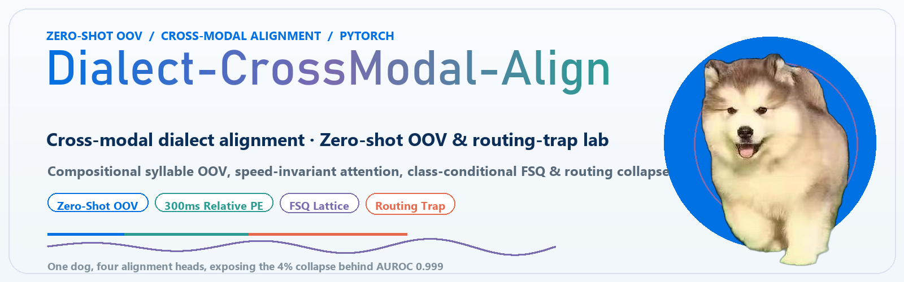
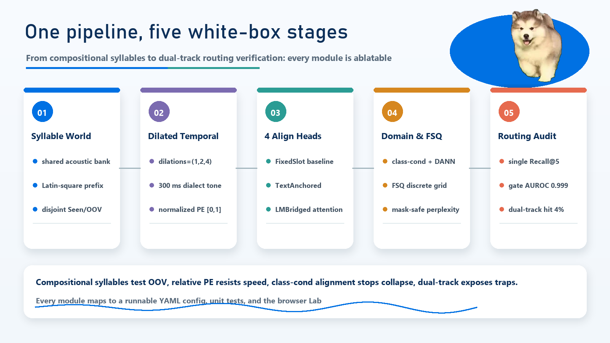

<p align="center">
  <a href="https://github.com/leeoisaboy/dialect-crossmodal-align">
    
  </a>
</p>

<p align="center">
  <a href="README.md"></a>
  <a href="https://leeoisaboy.github.io/dialect-crossmodal-align/"></a>
  <a href="https://leeoisaboy.github.io/disentangle-acoustic-print/"></a>
  <a href="https://leeoisaboy.github.io/audiollm-latent-kws/"></a>
  
  
</p>

<h1 align="center">Dialect-CrossModal-Align</h1>

<p align="center"><strong>A trainable, ablatable cross-modal dialect alignment benchmark—turning routing traps, compositional zero-shot OOV, speed-invariant attention, and FSQ discrete lattices into live white-box experiments.</strong></p>


## Architecture Pipeline

<p align="center">
  
</p>

## The Live Interactive Lab

<p align="center">
  <a href="https://leeoisaboy.github.io/dialect-crossmodal-align/">
    
  </a>
</p>

<p align="center"><strong><a href="https://leeoisaboy.github.io/dialect-crossmodal-align/">▶ Open CrossModal Align Lab</a></strong></p>

The animation mirrors the zero-backend browser Lab. Built as a borderless scroll story, every module animates autonomously as you scroll and hands over control the moment you drag or click: watch **AUROC 0.999 collapse to a 4% joint hit rate** under domain shift, trace unseen zero-shot OOV words back to shared training syllables, stretch speaking speed from `0.5x` to `2.0x` to test relative phase lock, and toggle **FSQ discrete lattice snapping** with mask-safe codebook perplexity.

| Module | What you explore live | Implementation |
| --- | --- | --- |
| 01 Routing Trap Simulator | Drag `gate_domain_shift (0.0 → -1.5)`: Recall@5 stays `100%` and AUROC stays `0.999`, while joint hit rate crashes `100% → 4%` | `eval_routing_trap.py`, `reports/routing_trap.json` |
| 02 Syllable LEGO × OOV Arena | 3-segment syllable provenance + 4-head OOV matrix PK (`FixedSlot` `0%` vs `LMBridged` `93.8%`) + `CosFace` temp annealing (`10 → 40`) | `data.py`, `heads.py`, `criteria.py` |
| 03 Temporal Microscope | Speed slider `0.5x ↔ 2.0x`: `dilations=(1,2,4)` (`300 ms`), Absolute PE drift vs Normalized Relative PE `[0,1]`, Q-Former vs Pairwise | `backbones.py`, `heads.py` |
| 04 Geometry & FSQ Lattice | 2D unit-sphere alignment (`None` vs `Marginal` collapse vs `Class-Conditional + DANN`) + FSQ snapping & mask-safe Perplexity | `domain_modules.py` |

## The Routing Trap: Why AUROC 0.999 Still Collapses to 4%

In `dialect_crossmodal_align/eval_routing_trap.py` (exact numbers in [reports/routing_trap.json](reports/routing_trap.json)), a binary gate threshold (`0.5862`) is calibrated at `target_fpr = 0.01` in-domain. Under a uniform cross-domain shift of `gate_domain_shift = -1.0`:

| Metric | In-Domain (`shift = 0.0`) | Shifted Domain (`shift = -1.0`) | What Happened |
| --- | ---: | ---: | --- |
| Single-Track `Recall@5` | **100.0%** (50/50) | **100.0%** (50/50) | The ranker itself is untouched |
| Gate `AUROC` | **0.9998** | **0.9990** | Relative ordering barely moves—deceptively high |
| Gate `FPR` | 3.0% | 0.0% | Negatives shift even further below threshold |
| Gate `TPR` | **100.0%** (50/50) | **4.0%** (2/50) | 96% of true positives slide behind the locked threshold wall |
| **Dual-Track Joint Hit Rate** | **100.0%** (50/50) | **4.0%** (2/50) | **Production recall collapses despite near-perfect single metrics** |

## Architecture & Core Mechanisms

<p align="center">
  
</p>

1. **Compositional Zero-Shot OOV World (`data.py`)**: `SyntheticDialectWorld` builds words from a shared `token_acoustic_bank` using a Latin-square prefix so the training split covers 100% of active syllables at every segment position while keeping `train_classes [0..7]` and `val_classes [8..11]` strictly disjoint.
2. **Four Alignment Heads (`heads.py`, `criteria.py`)**: Compare closed-set `FixedSlotHead` (`0%` OOV), `AudioToTextSpaceHead`, `TextAnchoredHead` (with `CosFaceProjection` 3 sub-centers annealed `10.0 → 40.0`), and `LMBridgedHead` (`qformer` & zero-dead-parameter `pairwise` with `siglip` / `infonce` / `multi_positive_infonce`).
3. **Speed-Invariant Temporal Modeling (`backbones.py`, `heads.py`)**: `LinearDialectAdapter(dilations=(1, 2, 4))` covers ~300 ms at 50 Hz; `NormalizedRelativePositionalEncoding` maps valid frames onto $r \in [0, 1]$ so cross-modal attention stays phase-locked across `0.5x–2.0x` speaking rates.
4. **Class-Conditional Domain Alignment & Mask-Safe FSQ (`domain_modules.py`)**: `domain_alignment_loss(..., labels=classes)` aligns per-class means and shrunk covariances across domains (avoiding small-batch marginal collapse) alongside `dann_alpha_schedule` and `FSQBottleneck.codebook_metrics(codes, mask=valid_mask)` with `int64` overflow tuple-hashing protection.

## Runnable Configs & Quick Start

```bash
# Preview the zero-backend interactive Lab locally
python -m http.server 8767 --directory studio

# Install and run tests + training configs + routing-trap audit
python -m pip install -e . pytest
pytest
python -m dialect_crossmodal_align.eval_routing_trap --output reports/routing_trap.json
python -m dialect_crossmodal_align.train --config configs/zero_shot_oov.yaml
python -m dialect_crossmodal_align.train --config configs/domain_regularized.yaml
```

## White-Box Speech Retrieval Trilogy

| Repository | Focus | Stack | Live Interactive Studio |
| --- | --- | --- | --- |
| **[disentangle-acoustic-print](https://github.com/leeoisaboy/disentangle-acoustic-print)** | Acoustic geometry disentanglement & 4-layer fingerprint oscilloscope | Pure NumPy · Training-free · 60 FPS Live Mic | [Acoustic Print Studio ↗](https://leeoisaboy.github.io/disentangle-acoustic-print/) |
| **[audiollm-latent-kws](https://github.com/leeoisaboy/audiollm-latent-kws)** | Frozen Audio-LLM two-stage retrieval & dual-grid leakage audit | Frozen LLM · 80ms/40ms Grids · 7 Negative Ablations | [Latent-KWS Audit Studio ↗](https://leeoisaboy.github.io/audiollm-latent-kws/) |
| **[dialect-crossmodal-align](https://github.com/leeoisaboy/dialect-crossmodal-align)** | Trainable cross-modal alignment, zero-shot OOV & routing-trap lab | PyTorch · Compositional OOV · Class-Cond FSQ | [CrossModal Align Lab ↗](https://leeoisaboy.github.io/dialect-crossmodal-align/) |
