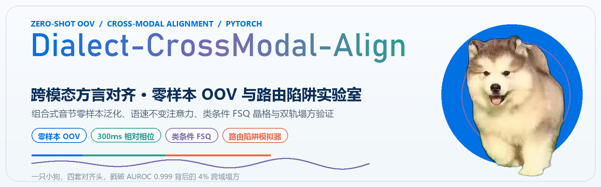
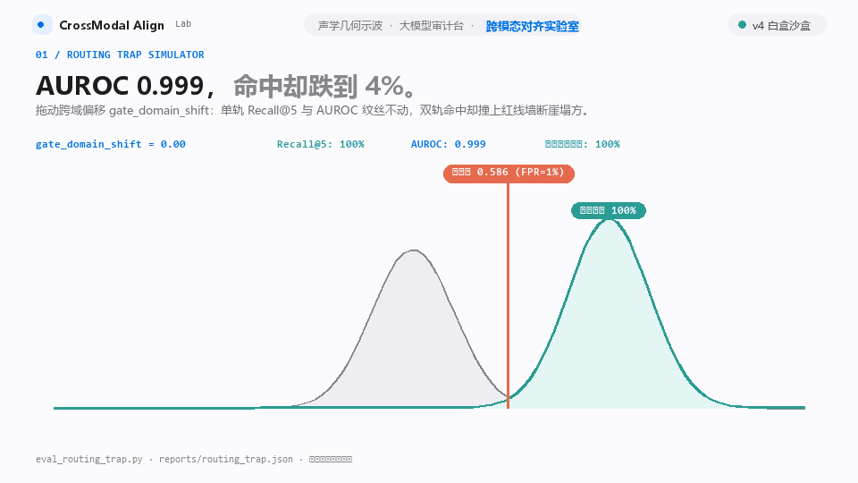
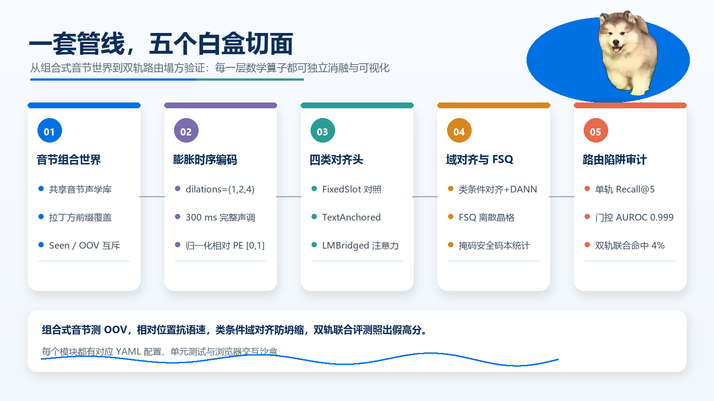

<p align="center">
  <a href="https://github.com/leeoisaboy/dialect-crossmodal-align">
    
  </a>
</p>

<p align="center">
  <a href="README.en.md"></a>
  <a href="https://leeoisaboy.github.io/dialect-crossmodal-align/"></a>
  <a href="https://leeoisaboy.github.io/disentangle-acoustic-print/"></a>
  <a href="https://leeoisaboy.github.io/audiollm-latent-kws/"></a>
  
  
</p>

<h1 align="center">Dialect-CrossModal-Align</h1>

<p align="center"><strong>面向低资源方言开放词表检索的可训练跨模态对齐基准：把路由陷阱、零样本 OOV、语速弹性注意力与 FSQ 离散晶格全部做成看得见的白盒实验。</strong></p>


## 方法流程图 · Architecture Pipeline

<p align="center">
  
</p>

## 正在运行的交互实验室

<p align="center">
  <a href="https://leeoisaboy.github.io/dialect-crossmodal-align/">
    
  </a>
</p>

<p align="center"><strong><a href="https://leeoisaboy.github.io/dialect-crossmodal-align/">▶ 进入在线 CrossModal Align Lab</a></strong></p>

这段动图直接还原了在线实验室的核心交互。页面采用无边框浅色长卷轴设计，零后端、纯本地运行，无需鼠标悬停也会随滚动自动演进：你可以手拖偏移滑块亲眼看 **AUROC 0.999 如何在跨域时暴跌到 4%**，用三段彩色音节乐高追踪 **从未见过的新词（Zero-Shot OOV）** 是如何被开放词表头拼出来的，拉伸语速对比绝对与归一化相对位置编码的相位咬合，并一键开启 **FSQ 离散晶格** 观察连续特征吸附与掩码安全码本统计。

| 模块 | 页面里你能直观看到什么 | 对应代码实现 |
| --- | --- | --- |
| 01 路由陷阱模拟器 | 拖动 `gate_domain_shift (0.0 → -1.5)`，亲眼看 AUROC 稳在 0.999、Recall@5 稳在 100%，双轨命中却撞上红线墙塌方到 4% | `eval_routing_trap.py`、`reports/routing_trap.json` |
| 02 音节乐高 × OOV 对决 | 声母/韵母/韵尾三段乐高连线溯源 + 四类对齐头零样本矩阵 PK + `CosFace` 3 子中心温度退火（10 → 40） | `data.py`、`heads.py`、`criteria.py` |
| 03 时序白盒显微镜 | 语速拉杆 `0.5x ↔ 2.0x`：1/2/4 膨胀感受野（300 ms）、绝对 PE 跑偏 vs 相对 PE `[0, 1]`、Q-Former vs Pairwise | `backbones.py`、`heads.py` |
| 04 域对齐 × FSQ 晶格 | 2D 单位球面（形状=词义，颜色=方言域）：无域正则 vs 边缘坍缩 vs 类条件+DANN + FSQ 吸附与掩码安全 Perplexity | `domain_modules.py` |

## 为什么做这个项目

在低资源方言语音检索里，很多团队从纯声学特征走到“训练一个轻量跨模态音文对齐头”时，最容易踩中四个隐蔽的坑：

1. **分开报分掩盖了线上崩溃**：开发时把排序 `Recall@5` 和门控 `AUROC` 分开看，两个指标都在 99% 以上；一换方言口音或麦克风信道，锁死的门控阈值把 96% 的真样本全部拦在门外。
2. **闭集分类头冒充“开放词表”**：传统分类头只认识训练集里的固定槽位，遇到用户新加的方言词根本没有锚点，零样本能力实际为 0。
3. **方言一拖长音或快读连音，时序就对齐失败**：标准绝对位置编码按毫秒计数，语速一变后半段音节全跑偏；普通窄卷积又看不到完整的 300 ms 方言声调轮廓。
4. **小批次域对齐反而把不同词挤成一团**：不按类别做域对齐（`labels=None`），在 batch 类别不均衡时会直接引发类间坍缩；开启 FSQ 量化后如果忘了屏蔽 padding 帧，码本困惑度与利用率会被大量零帧虚假拉低。

这个仓库把上述四个问题全部拆成**可独立训练、可一键消融、带完整单元测试与浏览器白盒沙盒**的干净 PyTorch 基准（v4）。

## 项目追问什么

1. **双轨路由陷阱**：为什么门控 `AUROC = 0.999`、排序 `Recall@5 = 100%`，双轨联合命中率却会在域偏移下断崖跌落到 `4%`？
2. **组合式零样本 OOV**：当训练词与测试词完全互斥、只共享底层音节时，四类跨模态头谁能真正泛化，谁会当场失效？
3. **语速鲁棒与感受野**：多层膨胀卷积与 `[0, 1]` 归一化相对位置编码，怎样让跨模态注意力在 `0.5x` 慢读和 `2.0x` 快读下保持相位一致？
4. **类条件域对齐**：相比直接拉拢全局边缘分布，按类别对齐均值与收缩协方差（配 DANN 梯度反转）如何避免小批次类间坍缩？
5. **离散量化与码本健康**：引入 FSQ 离散晶格后，如何做到掩码安全统计、独立帧级量化且避免高维码本索引 `int64` 溢出？
6. **训练/评估口径一致**：多子中心 `CosFaceProjection` 与 `LMBridgedHead` 在分布式训练与验证期怎样消除隐式间隔漂移与死参数？

## 路由陷阱：为什么 AUROC 0.999 仍会暴跌到 4%？

`dialect_crossmodal_align/eval_routing_trap.py` 构造了一个极简但极具警示意义的实证对照（完整报告见 [reports/routing_trap.json](reports/routing_trap.json)）：在开发集负样本上按 `target_fpr = 0.01` 锁死门控阈值 `threshold = 0.5862`；随后在测试集（50 正样本 + 200 负样本）上施加一个统一的跨域偏移 `gate_domain_shift = -1.0`（正负样本门控分同时左移 1.0，彼此相对排序不变）：

| 评测维度 | 同域测试 (`shift = 0.0`) | 跨域偏移 (`shift = -1.0`) | 背后发生了什么 |
| --- | ---: | ---: | --- |
| 单轨排序 `Recall@5` | **100.0%** (50/50) | **100.0%** (50/50) | 排序网络本身完全没坏 |
| 门控分类 `AUROC` | **0.9998** | **0.9990** | 正负相对顺序几乎不变，指标极具欺骗性 |
| 门控 `FPR`（误报率） | 3.0% | 0.0% | 负样本更远离阈值墙 |
| 门控 `TPR`（真样本通过率） | **100.0%** (50/50) | **4.0%** (2/50) | **96% 的正样本滑到了红色阈值墙左侧被直接拒掉** |
| **双轨联合命中率** | **100.0%** (50/50) | **4.0%** (2/50) | **单看任何一项单轨指标都以为系统完美，上线直接瘫痪** |

> 这就是为什么不能只盯单个 `AUROC` 或单个 `Recall@K`——跨域部署必须做**联合双轨评估**与**域自适应校准**。

## 核心方法与架构

<p align="center">
  
</p>

### 1. 组合式零样本 OOV 合成世界（`data.py`）
`SyntheticDialectWorld` 维护一个共享音节声学库 `token_acoustic_bank`，每个词由 3 个有序音节（声母 Onset → 韵母 Nucleus → 韵尾 Coda）拼接生成。为了防止出现“测试词包含训练从未听过的孤立音素”这种不公平评测，前 `S` 个训练词采用**拉丁方前缀（Latin-Square Prefix）**，保证所有底层音节在每一个位置上都被训练词 100% 覆盖；随后再将 `train_classes: [0..7]` 与 `val_classes: [8..11]` 严格互斥切分，并用 `max_tokens = num_segments` 消除静默尾部 token 捷径。

### 2. 四种跨模态对齐头对比（`heads.py` & `criteria.py`）

| 对齐头 | 机制说明 | 零样本 OOV 能力 | 适用场景 |
| --- | --- | --- | --- |
| `FixedSlotHead` | 固定槽位闭集分类头，权重仅对应训练词表 | **无（0%）** | 闭集对照基线，用来反证开放词表必要性 |
| `AudioToTextSpaceHead` | 冻结文本锚点空间，单向把声学特征映射进文本空间 | **支持** | 轻量、小样本下保护文本几何不被拉变形 |
| `TextAnchoredHead` | 声学与文本锚点双向对齐，配合 `CosFaceProjection` 3 子中心与温度退火（`10.0 → 40.0`） | **强** | 推荐默认开放词表基线 |
| `LMBridgedHead` | 注入 `[0, 1]` 归一化相对位置编码，支持 `Q-Former`（4 潜查询）与 `Pairwise`（音节-帧交叉注意力） | **最强** | 需要细粒度音节相位对齐与语速鲁棒的开放词表检索 |

### 3. 膨胀感受野 × 语速弹性时序建模（`backbones.py` & `heads.py`）
- **300 ms 膨胀感受野**：`LinearDialectAdapter` 采用三层膨胀卷积 `dilations=(1, 2, 4)`，在 50 Hz（20 ms/帧）声学输入下将有效感受野平滑扩展至 ~300 ms，刚好罩住一个完整方言音节的声调转折。
- **语速不变相对位置编码**：`NormalizedRelativePositionalEncoding` 将每条语音的有效帧区间严格归一化到 $r \in [0, 1]$，无论说话人 `0.5x` 慢速拖音还是 `2.0x` 快速连读，正弦位置条纹都像橡皮筋一样紧贴声母/韵母/韵尾。
- **双模式跨模态交互**：`qformer` 模式用 4 个 `latent_queries` 自动分工盯住不同相位；`pairwise` 模式单次编码复用文本序列、零死参数（不注册多余查询参数，消除 DDP `unused parameter` 报错），并完整支持 `siglip` / `infonce` / `multi_positive_infonce`。

### 4. 类条件域对齐 × FSQ 离散晶格（`domain_modules.py`）
- **类条件域对齐（`domain_alignment_loss(..., labels=classes)`）**：只在相同词类内部对齐不同方言域的一阶均值与收缩协方差，彻底规避小批次类别不均衡时普通边缘对齐导致的“跨词混叠坍缩”。
- **DANN 梯度反转调度（`dann_alpha_schedule`）**：按 $\alpha(p) = \frac{2}{1 + e^{-\gamma p}} - 1$（默认 $\gamma = 10$）平滑递增对抗权重，前期先学稳语义，后期再剥离方言域偏移。
- **掩码安全 FSQ 离散晶格（`FSQBottleneck`）**：支持可配置 `fsq_levels`（如 `[5, 5, 5, 5, 5, 5]`），为 `lm_bridged` 独立实例化 `sequence_fsq`；码本指标 `codebook_metrics(codes, mask=valid_mask)` 严格过滤 padding 帧，避免 Perplexity 与 Unique Code Ratio 被零填充帧虚假拉低，并对 $\prod L_i \ge 2^{62}$ 提供 `int64` 溢出元组哈希保护。

## v4 版本的 4 项关键工程精修

| 遗留隐患（v3） | 问题根因 | v4 精准修复 |
| --- | --- | --- |
| `CosFaceProjection` 训/评口径漂移 | 训练用平滑 LSE、评估用硬 max，且未显式切换模式 | `train.py` 显式调用 `criterion.train()/eval()`，训练期将 `sub_center_temp` 从 `10.0` 平滑退火至 `40.0` |
| `LMBridgedHead` `pairwise` 死参数与重复编码 | 始终注册未使用的 `latent_queries`，且重复编码文本 | 仅 `qformer` 注册 `latent_queries`；`pairwise` 单次编码复用并补齐 `pairwise_siglip` |
| FSQ 码本指标失真与高维溢出 | 未过滤 padding 帧且直接累乘 `int64` 索引 | 独立 `sequence_fsq` + `mask=valid_mask` 过滤 + $\ge 2^{62}$ 元组哈希保护 |
| 优化器衰减错配与无 gallery 评测失真 | `log_scale`/`LayerNorm`/1D 参数进入 weight decay；无 gallery 时写死 Recall@3=Recall@1 | 拆分 `decay / no_decay` 分组 + Warmup Cosine；统一用 `_multi_positive_ranking_metrics` 计算真实 Recall@1/3 与 MRR |

## 6 套即跑即用的实验配置

| 配置文件 | 测试重点 | 一键运行命令 |
| --- | --- | --- |
| `configs/fixed_slot.yaml` | 闭集槽位对照基线 | `python -m dialect_crossmodal_align.train --config configs/fixed_slot.yaml` |
| `configs/text_anchored.yaml` | 文本锚点开放词表基线 | `python -m dialect_crossmodal_align.train --config configs/text_anchored.yaml` |
| `configs/audio_to_text_space.yaml` | 冻结文本空间单向投影 | `python -m dialect_crossmodal_align.train --config configs/audio_to_text_space.yaml` |
| `configs/lm_bridged.yaml` | 相对位置 + Q-Former / Pairwise 跨模态交互 | `python -m dialect_crossmodal_align.train --config configs/lm_bridged.yaml` |
| `configs/zero_shot_oov.yaml` | 12 类互斥切分（训练 0–7 / 零样本 OOV 8–11） | `python -m dialect_crossmodal_align.train --config configs/zero_shot_oov.yaml` |
| `configs/domain_regularized.yaml` | 3 域 OOD + 类条件对齐 + DANN + FSQ 晶格 | `python -m dialect_crossmodal_align.train --config configs/domain_regularized.yaml` |

## 快速开始

### 1. 本地打开 CrossModal Align Lab（零后端依赖）
```bash
python -m http.server 8767 --directory studio
```
浏览器打开 `http://127.0.0.1:8767` 即可体验全部四个交互模块。

### 2. 安装并运行 PyTorch 基准与单元测试
```bash
git clone https://github.com/leeoisaboy/dialect-crossmodal-align.git
cd dialect-crossmodal-align
python -m venv .venv
python -m pip install -e . pytest

pytest
python -m dialect_crossmodal_align.eval_routing_trap --output reports/routing_trap.json
python -m dialect_crossmodal_align.train --config configs/zero_shot_oov.yaml
```

## 代码结构

```text
dialect-crossmodal-align/
├── dialect_crossmodal_align/
│   ├── data.py                  SyntheticDialectWorld 组合式零样本 OOV 合成世界
│   ├── backbones.py             LinearDialectAdapter（dilations=(1,2,4) 覆盖 300 ms）
│   ├── aggregators.py           掩码安全 MultiStatisticPNAPooling
│   ├── heads.py                 FixedSlot / TextAnchored / AudioToTextSpace / LMBridged
│   ├── criteria.py              CosFaceProjection 温度退火、SigLIP、Multi-Positive InfoNCE
│   ├── domain_modules.py        类条件域对齐、DANN 调度、FSQBottleneck 与掩码安全码本统计
│   ├── model.py                 统一跨模态对齐模型装配
│   ├── train.py                 decay/no_decay 优化器、Warmup Cosine 与统一排序评测
│   └── eval_routing_trap.py     双轨路由陷阱模拟器（复现 AUROC 0.999 → 4%）
├── configs/                     6 套即跑即用的消融 YAML 配置
├── studio/                      零后端 CrossModal Align Lab 静态前端（GitHub Pages）
├── scripts/
│   ├── export_lab_bundle.py     导出 studio/data/lab_bundle.json
│   ├── make_assets.py           生成小狗 LOGO、中英标题图与五阶段架构图
│   └── make_lab_demo_gif.py     生成 README 动态演示 GIF
├── docs/                        数据契约、模块地图与视觉资产
├── reports/routing_trap.json    路由陷阱实测报告
└── tests/test_align.py          完整单元测试
```

## 白盒语音检索三部曲

三个仓库共用同一套浅色白盒实验台美学与「不藏失败、用实证说话」的工程哲学，从不同切面回答低资源方言语音检索问题：

| 项目 | 核心定位 | 底层形态 | 在线交互界面 |
| --- | --- | --- | --- |
| **[disentangle-acoustic-print](https://github.com/leeoisaboy/disentangle-acoustic-print)** | 声学几何解耦与四层指纹示波器 | 纯 NumPy · 免训练 · 支持 60 FPS 实时麦克风 | [Acoustic Print Studio ↗](https://leeoisaboy.github.io/disentangle-acoustic-print/) |
| **[audiollm-latent-kws](https://github.com/leeoisaboy/audiollm-latent-kws)** | 冻结 Audio-LLM 两阶段检索与防泄漏审计台 | 冻结大模型 · 80ms/40ms 双网格 · 7 项公开阴性实验 | [Latent-KWS Audit Studio ↗](https://leeoisaboy.github.io/audiollm-latent-kws/) |
| **[dialect-crossmodal-align](https://github.com/leeoisaboy/dialect-crossmodal-align)** | 可训练跨模态对齐与路由陷阱实验室 | PyTorch · 组合式零样本 OOV · 类条件 FSQ 晶格 | [CrossModal Align Lab ↗](https://leeoisaboy.github.io/dialect-crossmodal-align/) |
