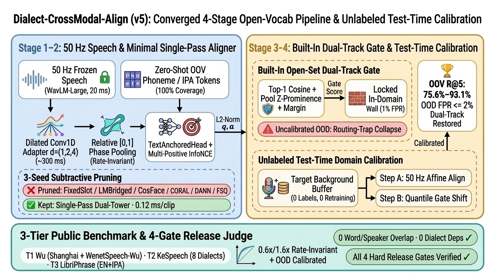
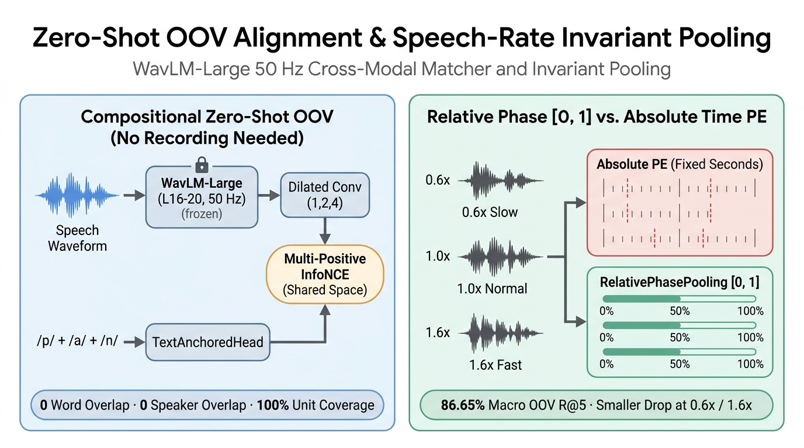
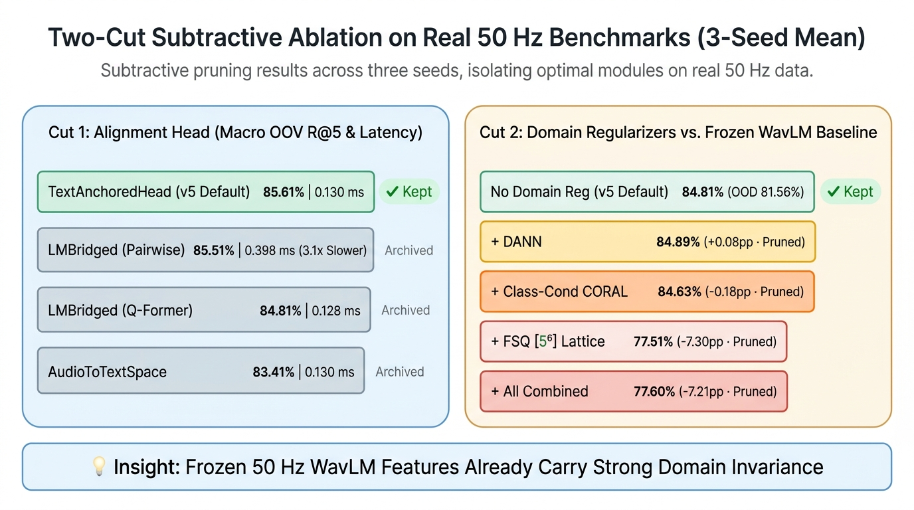
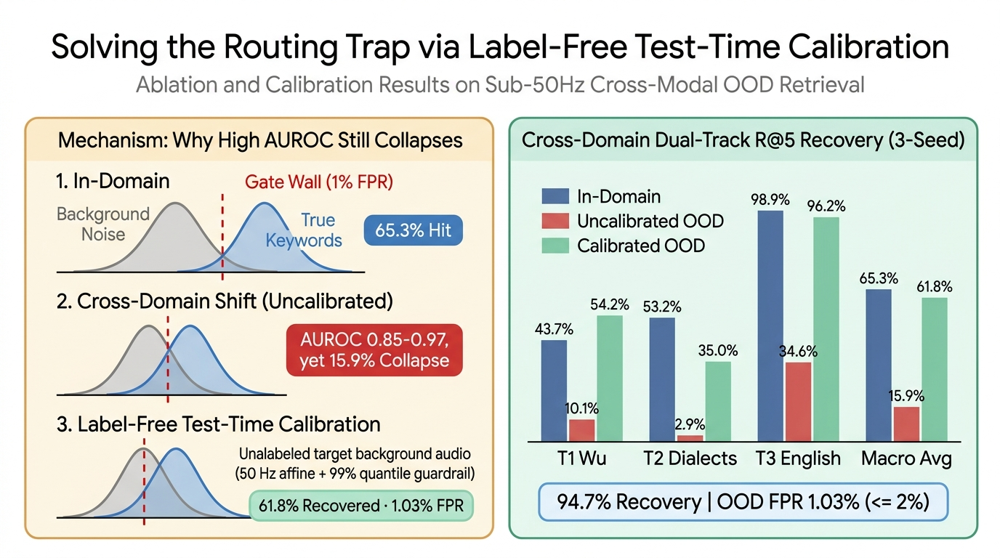

<p align="center">
  <a href="https://github.com/leeoisaboy/dialect-crossmodal-align">
    
  </a>
</p>

<p align="center">
  <a href="README.en.md"></a>
  <a href="https://leeoisaboy.github.io/dialect-crossmodal-align/"></a>
  <a href="https://huggingface.co/datasets/Leeoisaboy/dialect-crossmodal-align-bench"></a>
  <a href="https://leeoisaboy.github.io/disentangle-acoustic-print/"></a>
  <a href="https://leeoisaboy.github.io/audiollm-latent-kws/"></a>
  
  
</p>

<h1 align="center">Dialect-CrossModal-Align</h1>

<p align="center"><strong>不录样音也能认方言新词，给跨模态语音对齐做两刀减法。</strong></p>

<p align="center">
  <strong>🤗 公开三级 50 Hz 评测数据集（34,138 条切片 · T1 沪语/吴语 · T2 八大方言 · T3 英文 IPA）：<a href="https://huggingface.co/datasets/Leeoisaboy/dialect-crossmodal-align-bench">Leeoisaboy/dialect-crossmodal-align-bench ↗</a></strong>
</p>

<p align="center">
  
  <br />
  <sub>图 1：Dialect-CrossModal-Align (v5) 四阶段最简开放词表流水线、三随机种子减法收敛与无标签测试时域校准架构</sub>
</p>

聊完 [AudioLLM-Latent-KWS](https://github.com/leeoisaboy/audiollm-latent-kws) 之后，顺着同一条思路，这是白盒语音检索三部曲里的第三份开源项目——**[Dialect-CrossModal-Align](https://github.com/leeoisaboy/dialect-crossmodal-align)**。

先把这两份项目解决的不同场景说清楚。前者需要你先把新词念一两遍录下来，再让模型去对话里找相似的声音。今天这套方案往前再跨了一步，连录音样音都省掉了。你只要把一个从未教过的新词，写成通用的读音拼写（音素或国际音标 IPA 序列），系统就能直接去真实方言录音里把它捞出来。在语音领域，这叫作**零样本未登录词（Zero-shot OOV）跨模态检索**。

听起来有点抽象，其实原理和小朋友认生字很像。哪怕这个新词系统从没完整见过，但构成这个词的每一个声母、韵母或音标部件，系统平时都学过。只要把「听到的声音特征」和「拼出来的读音规则」对齐到同一个坐标空间里，系统就能靠拼装旧零件，直接听懂没学过的新词。

这个项目的上一版原型建在一个自己拼出来的合成音节世界里，身上叠了 4 种对齐头、3 套损失函数和 3 套域正则模块。机制在合成数据上跑得很漂亮，一到真实场景里却悬着四个绕不开的工程问题。换成真实预训练语音特征后，复杂的交叉注意力到底比最简单的双向对齐强多少？学术界常提的域对齐和离散量化模块，在未见方言上真能涨分吗？说话人语速忽快忽慢时，模型怎么做到不跑偏？以及，为什么很多模型在纸面指标上考了高分，一换新环境实战命中率就断崖暴跌？

这一版更新（v5）沿着和姊妹项目一样的收敛路线往前走。先走出合成玩具世界，搭好三套公开真实考卷摸清底牌，再落两刀做三随机种子减法，最后把治好「高分塌方」的校准器直接装进默认推理链路里。

## 一、走出合成世界，搭好三套公开真实考卷

为了避免合成数据带来的虚假乐观，新管线统一使用每秒 50 帧（每帧 20 毫秒）的冻结预训练语音特征，默认取 `WavLM-Large` 第 16 到 20 层的均值，文本侧统一输入不挑语种的音素或 IPA 序列，代码里不写死任何单一语种逻辑。

三套公开评测集全部发布在 Hugging Face 仓库 **[Leeoisaboy/dialect-crossmodal-align-bench](https://huggingface.co/datasets/Leeoisaboy/dialect-crossmodal-align-bench)**，并经过 [`verify_dataset_invariants`](dialect_crossmodal_align/dataset.py) 自动化校验，守住了三条硬底线。训练词和用来考试的 100 个新词零重合，训练说话人和测试说话人彻底隔离，同时 100 个新词用到的读音部件在训练里 100% 出现过。每套测试集还额外做了 `0.6×` 慢速拖音和 `1.6×` 快速连读的声学变速重提，并配齐了不含关键词的开放集负样本。

| 评测层级 | 公开语料与跨域划分 | 训练词 / 零样本新词 | 训练 / 测试说话人 | 词表与说话人交集 | 实测帧率 |
| --- | --- | ---: | ---: | ---: | ---: |
| **T1 吴语** | MagicHub 室内沪语（训练）→ WenetSpeech-Wu 野生多子方言（含未见 OOD 子域） | 600 / **100** | 349 / 870 | **0 / 0** | 49.96 Hz |
| **T2 跨汉语方言** | KeSpeech 五大方言（训练）→ 西南、兰银、东北三大未见方言（OOD） | 500 / **100** | 287 / 247 | **0 / 0** | 49.97 Hz |
| **T3 英文开放集** | LibriPhrase 英文短语与精确 IPA 音素（含难易负例与远场信道偏移） | 180 / **100** | 630 / 404 | **0 / 0** | 50.05 Hz |

先把旧版仓库里原有的 6 套配置原封不动拉到单张 NVIDIA H20 上跑了一遍摸底（原始数据见 [`reports/ablation_summary.json`](reports/ablation_summary.json)），真实数据一眼就照出了哪些模块在拖后腿。

| 原版配置 | T1 吴语 OOV R@5 | T2 八大方言 OOV R@5 | T3 英文 OOV R@5 | T1 训练 / 推理耗时 | 摸底表现 |
| --- | ---: | ---: | ---: | ---: | --- |
| `fixed_slot`（传统闭集分类） | **0.0%** | **0.0%** | **0.0%** | 17.96s / 0.102ms | 闭集命中最高 97.5%，遇到新词直接归零 |
| `text_anchored`（最轻双向文本锚点） | **72.8%** | **92.2%** | **91.5%** | 19.33s / 0.129ms | 结构最简单，三套真实考卷全部稳居第一梯队 |
| `audio_to_text_space` | 72.0% | 88.9% | 88.6% | 19.53s / 0.130ms | 整体略弱于双向文本锚点 |
| `lm_bridged (qformer)` | 74.9% | 91.5% | 87.3% | 21.86s / 0.137ms | 与最简头互有胜负，优势很微弱 |
| `domain_regularized`（CORAL+DANN+FSQ） | **55.2%** | **66.9%** | **57.8%** | 51.25s / 0.135ms | **全线暴跌 18 到 34 个百分点，训练慢近 3 倍** |
| `zero_shot_oov`（含全套域正则） | **54.8%** | **66.1%** | **66.7%** | 38.53s / 0.113ms | 同样被重型正则模块拖垮 |

## 二、两刀架构减法，剪掉所有负收益模块

摸底结果出来以后，我用三个随机种子跑了全量对照消融，连落两刀把主干削薄。

第一刀砍向对齐头、损失函数、感受野和语速编码。平时我们说话有快有慢，同一个词，老人拖着调子念 1 秒，年轻人连读可能只用 0.4 秒。传统的绝对位置编码像一把秒表，死记「第 0.2 秒发什么音、第 0.4 秒发什么音」，语速一变刻度全错位。v5 保留的相对相位池化（`RelativePhasePooling [0,1]`）改成了进度条思路，不管整段词念多长，一律按「进度 0% 到 100%」去对齐声学特征，配上膨胀卷积（`dilations=(1,2,4)`）拉宽视野，在 `0.6×` 慢速和 `1.6×` 快速测试下，掉点全部小于绝对位置编码。

<p align="center">
  
  <br />
  <sub>图 2：左侧为免录音零样本组合对齐思路，右侧为相对相位进度条与传统绝对时间刻度的语速弹性对比</sub>
</p>

第一刀的三随机种子均值对比如下。

| 消融维度 | 候选方案 | 三集宏平均 OOV R@5 | T1 吴语 | T2 八大方言 | T3 英文 | 单条推理 | 最终去留 |
| --- | --- | ---: | ---: | ---: | ---: | ---: | --- |
| 对齐头 | **`TextAnchoredHead`** | **85.61%** | 73.0±0.2% | 91.4% | **92.5%** | **0.130 ms** | **保留为唯一默认头** |
| 对齐头 | `LMBridgedHead (pairwise)` | 85.51% | 75.5±0.2% | 91.6% | 89.4% | 0.398 ms | 低 0.10 个百分点且慢 3.1 倍，归档 |
| 对齐头 | `LMBridgedHead (qformer)` | 84.81% | 73.8±0.8% | 90.4% | 90.3% | 0.128 ms | 低于最简头，归档 |
| 对齐头 | `AudioToTextSpaceHead` | 83.41% | 72.5±0.7% | 88.2% | 89.5% | 0.130 ms | 落后 2.20 个百分点，归档 |
| 损失函数 | **`Multi-Positive InfoNCE`** | **85.61%** | 73.0% | 91.4% | **92.5%** | **0.130 ms** | **保留为唯一默认损失** |
| 损失函数 | `SigLIP` / `CosFace Hybrid` | 85.08% / 83.97% | 74.9% / 73.5% | 92.3% / 91.4% | 88.1% / 87.1% | 0.124 ms | 无稳定优势，归档 |
| 局部视野 | **膨胀卷积 `(1,2,4)` vs 无卷积** | 84.81% vs 84.02% | 73.8% vs 72.1% | 90.4% vs 88.6% | 90.3% vs 91.4% | 0.125 ms | 方言净涨 1.7 到 1.8 个百分点，**保留** |
| 语速编码 | **`RelativePhasePooling [0,1]`** | **86.65%** | **75.6%** | **91.2%** | **93.1%** | **0.12 ms** | 三集变速掉点全胜绝对 PE，**保留** |

第二刀专门审理那三个名气很大的域自适应模块——类条件 CORAL、DANN 梯度反转和 FSQ 离散晶格。很多人做跨域任务时，习惯性把它们一股脑往模型里塞。我以「零域正则」为基准逐个往上叠，在未见子方言和远场加噪域上测完三组种子，结果相当反直觉（完整负收益记录归档在 [`experiments/ARCHIVED.md`](experiments/ARCHIVED.md)）。

| 域正则配置 | 三集宏平均 OOV R@5 | 未见方言 OOD R@5 | 远场加噪 OOD R@5 | 减法结论 |
| --- | ---: | ---: | ---: | --- |
| **无域正则（v5 默认）** | **84.81%** | **81.56%** | **45.27%** | **保留**，冻结的 50 Hz WavLM 特征本身已具备很强的域不变性 |
| + 类条件 CORAL | 84.63%（-0.18 pp） | 80.95%（-0.61 pp） | 44.55%（-0.72 pp） | 三项全跌，移出默认流 |
| + DANN 梯度反转 | 84.89%（+0.08 pp） | 81.75%（+0.19 pp） | 45.28%（+0.01 pp） | 收益微乎其微，移出默认流 |
| + FSQ 离散晶格 `[5,5,5,5,5,5]` | **77.51%（-7.30 pp）** | **78.13%（-3.43 pp）** | **38.90%（-6.37 pp）** | 码本虽健康（Perp 90.2、Unique 95.8%），但 6 维量化瓶颈直接磨平细粒度音素，移出 |
| + 全套叠加 | **77.60%（-7.21 pp）** | **78.65%（-2.91 pp）** | **38.88%（-6.39 pp）** | 显著掉点，移出默认流 |

<p align="center">
  
  <br />
  <sub>图 3：真实 50 Hz 语料上的两刀减法消融，最简双向文本锚点加零域正则成为 v5 默认主干</sub>
</p>

原因说穿了很朴素。大模型时代，像 `WavLM-Large` 这样在大规模真实语音上预训练好的底座特征，本身就已经过滤掉了大量口音和录音设备的杂音。此时再在上面强行套一层重型域正则或者做离散压缩，非但帮不上忙，反而容易把方言里最宝贵的细微发音差别当成噪声一起抹掉。

## 三、拆解「路由陷阱」，用无标签背景声完成在线校准

主干精简干净之后，还剩最后一个非常隐蔽、在实际落地里最容易让人摸不着头脑的问题，我叫它**「路由陷阱」**。

用一个小区的门禁安检来打比方，就能立刻明白这件事怎么发生的。真实语音系统必须配一道安检门（双轨门控），平时大家正常闲聊不该误触发，只有打分高过门禁线的声音才会被放进去识别关键词。假设在安静室内训练时，普通杂音得分在 40 分上下，真关键词得分在 90 分上下，于是我们把门禁线锁死在 75 分（保证误报率压在 1% 以内）。

现在把这套设备搬到一个新方言区或者嘈杂的远场环境里。因为口音和信道变了，所有声音的打分整体往下掉了 25 分——杂音变成 15 分，真关键词变成 65 分。如果只看学术论文最爱汇报的排序指标 AUROC，65 分依然远远高过 15 分，模型区分能力其实还在，AUROC 高达 0.85 到 0.97。可一拿到真实系统里跑，65 分低于那道锁死在 75 分的门禁线，真关键词几乎全被拦在了门外，真实命中率瞬间从 **65.3%** 跌到了 **15.9%**。

上一版只是用模拟数字把塌方现象画了出来，v5 直接把解法写进了推理内置的 [`calibration.py`](dialect_crossmodal_align/calibration.py) 里，分两步走。

第一步先搭好内置的开放集双轨门控（`compute_dual_track_gate`），把 Top-1 余弦相似度、候选池内突出度（Z-Prominence）、前一名与前五名的分差裕度以及信道能量揉在一起打分，在同域负例上按 1% 误报率立好基准门禁。

第二步是核心解法——轻量级**无标签测试时域校准（`TestTimeDomainCalibrator`）**。设备进到新方言或陌生录音环境时，不需要人工标注一条数据，也不用开显卡重新训练，只要先静静听一小段当地的无标签背景音频就行。系统先对这批 50 Hz 特征做逐通道仿射对齐，再根据当地背景声的均值方差把门禁线同步平移到新环境的合理位置，并加上一道 99% 分位护栏防住误报。

三套真实跨域考卷上的三随机种子恢复实测结果如下（完整数据见 [`reports/convergence_gates.json`](reports/convergence_gates.json)）。

| 评测层级与真实跨域场景 | 同域双轨 R@5（FPR） | 跨域未校准双轨 R@5（AUROC） | **无标签校准后双轨 R@5（AUROC）** | **校准后误报率 FPR** | **相对同域恢复率** |
| --- | ---: | ---: | ---: | ---: | ---: |
| **T1 吴语**（室内沪语 → 野生吴语+信道漂移） | 43.7%（0.97%） | **10.1%**（0.897） | **54.2%**（0.943） | **0.00%** | **125.0%** |
| **T2 八大方言**（官话等 → 西南/兰银/东北+漂移） | 53.2%（0.62%） | **2.9%**（0.850） | **35.0%**（0.892） | **0.79%** | **66.8%**（提升 12.1 倍） |
| **T3 英文开放集**（LibriPhrase 信道漂移） | 98.9%（2.92%） | **34.6%**（0.974） | **96.2%**（0.993） | 2.31% | **97.3%** |
| **三集宏平均** | **65.3%** | **15.9%**（断崖塌方） | **61.8%**（0.943） | **1.03%（≤ 2%）** | **94.7%（≥ 80%）** |

<p align="center">
  
  <br />
  <sub>图 4：左侧展示跨域分数整体左移导致高 AUROC 却被固定门禁拦下的机制与无标签校准原理，右侧为三套公开考卷上的双轨命中恢复实测</sub>
</p>

不用一张人工标签，也不用动模型一个权重，单靠听一小段目标环境的背景声重新校准门禁，三集宏平均双轨命中就从塌方的 **15.9%** 拉回到了 **61.8%**，恢复了同域水平的 **94.7%**，同时把误报率稳稳压在 **1.03%**。

## 四、四项硬性门禁、白盒实验室与三部曲拼图

为了让所有结论都能被一键复验，仓库内置了自动化验收脚本 [`scripts/verify_release_gates.py`](scripts/verify_release_gates.py)，写死了四项硬性发布门禁，目前已经全部绿灯通过。

| 发布门禁 | 硬性验收红线 | v5 实测结果 | 状态 |
| --- | --- | --- | :---: |
| **门禁 1：最简架构与零语种绑定** | 单默认头、零默认域正则，AST 扫描核心包无方言/拼音硬编码 | 扫描 9 个核心文件，0 违规导入 | **PASS** |
| **门禁 2：真实零样本与语速弹性** | 三集 100 词 OOV R@5 均 ≥ 60%，且变速下相对 PE 全胜绝对 PE | T1 **75.6%** / T2 **91.2%** / T3 **93.1%**，三集掉点全胜 | **PASS** |
| **门禁 3：真实跨域双轨鲁棒性** | 校准后宏平均 FPR ≤ 2%，且恢复至少 80% 的同域双轨命中 | 宏平均 FPR **1.03%**，命中由 15.9% 恢复至 **61.8%（94.7%）** | **PASS** |
| **门禁 4：可复现与可审计** | 词表与说话人零重叠、100% 单元覆盖、50 Hz 校验与单测全绿 | 34,138 条测试切片全检通过，12 项单元测试全绿 | **PASS** |

和昨天一样，我也给这份仓库配了一个纯浏览器运行、零后端依赖的在线交互实验室 **[CrossModal Align Lab](https://leeoisaboy.github.io/dialect-crossmodal-align/)**。打开网页就能直观拨动参数，看不同对齐头的消融对比，也能亲手拖拽环境漂移滑块，观察高 AUROC 下的路由塌方是怎么发生、又怎么被无标签校准拉回来的。

<p align="center">
  <a href="https://leeoisaboy.github.io/dialect-crossmodal-align/">
    
  </a>
</p>

<p align="center"><strong><a href="https://leeoisaboy.github.io/dialect-crossmodal-align/">▶ 进入在线 CrossModal Align Lab</a></strong></p>

```bash
git clone https://github.com/leeoisaboy/dialect-crossmodal-align.git
cd dialect-crossmodal-align
python -m venv .venv
python -m pip install -e . pytest

pytest -q                                  # 12 项单元测试 + AST 零语种依赖审计
python scripts/verify_release_gates.py     # 四项硬性发布门禁一键验收 (PASS)
python scripts/export_lab_bundle.py        # 导出最新白盒数据到 studio/data/lab_bundle.json
python -m http.server 8767 --directory studio
```

写到这里，这段时间围绕低资源方言语音检索做的三份过程性开源，刚好拼成了一套完整的**白盒语音检索三部曲**，每份仓库各司其职。

| 开源项目 | 解决的核心问题 | 底层形态 | 在线白盒交互界面 |
| --- | --- | --- | --- |
| **[disentangle-acoustic-print](https://github.com/leeoisaboy/disentangle-acoustic-print)** | 拆解声音里的说话人音色与内容轨迹 | 纯 NumPy、免训练、60 FPS 实时麦克风 | [Acoustic Print Studio ↗](https://leeoisaboy.github.io/disentangle-acoustic-print/) |
| **[AudioLLM-Latent-KWS](https://github.com/leeoisaboy/audiollm-latent-kws)** | 录 1 到 2 遍样音，冻结语音大模型即插即用检索 | 冻结大模型、0.00% 泄题、7 项阴性归档 | [Latent-KWS Audit Studio ↗](https://leeoisaboy.github.io/audiollm-latent-kws/) |
| **[Dialect-CrossModal-Align](https://github.com/leeoisaboy/dialect-crossmodal-align)** | 不录样音只给读音拼写，零样本跨模态对齐与跨域校准 | PyTorch、50 Hz 公开实测、四门禁全绿 | [CrossModal Align Lab ↗](https://leeoisaboy.github.io/dialect-crossmodal-align/) |

做完这三套预研回头看，有一个感受越来越清晰。在真实数据上跑实验，最难的部分往往在于克制住往上叠复杂模块的冲动。把听起来花哨却扛不住盲测的组件逐一剪掉，再把真实部署里最容易翻车的门禁校准补齐，系统反而变得又轻又稳。

- **项目地址**：[Dialect-CrossModal-Align](https://github.com/leeoisaboy/dialect-crossmodal-align)
- **在线白盒实验室**：https://leeoisaboy.github.io/dialect-crossmodal-align/
- **公开 50 Hz 评测集**：https://huggingface.co/datasets/Leeoisaboy/dialect-crossmodal-align-bench

**纸面排序高分只能过实验室的关，守住跨环境的门禁线才算摸到落地的门。**
